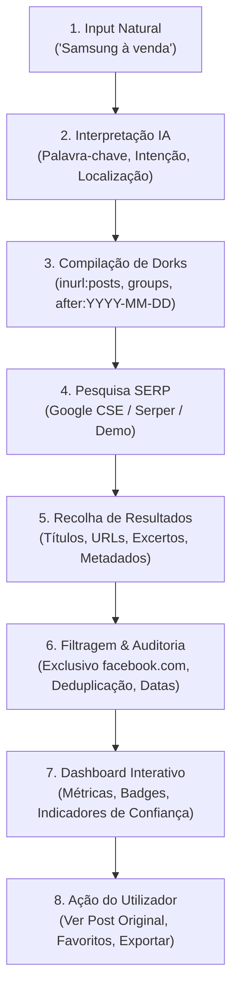

# SocialFind Intelligence

> **Plataforma SaaS de Descoberta Avançada de Publicações Públicas no Facebook através de Google Dorks e Filtros Temporais Inteligentes.**

Inspirado na linguagem estética minimalista, elegante e de alta precisão da engenharia suíça ([hodl.swiss](https://hodl.swiss/)).

---

## 🌟 Visão Geral do Produto

O **SocialFind Intelligence** resolve uma limitação crítica no ecossistema de inteligência em fontes abertas (OSINT) e pesquisa de mercado: a incapacidade da API oficial do Facebook de fornecer pesquisas amplas e flexíveis em publicações públicas em tempo real.

Em vez de scraping ilegal ou automações de contas privadas, o SocialFind Intelligence atua como um **compilador semântico de Google Dorks**:
1. O utilizador escreve o que procura em linguagem natural (ex: *"Samsung à venda"* ou *"Casas para arrendar em Luanda"*).
2. O motor interpreta a intenção (venda, emprego, imobiliário, etc.) e localizações geográficas.
3. Compila automaticamente múltiplas variações avançadas de **Google Dorks** (ex: `site:facebook.com (inurl:posts OR inurl:permalink) "termo" after:YYYY-MM-DD`).
4. Consulta fornecedores de resultados SERP (Google Programmable Search Engine ou Serper.dev) ou opera em **Modo Demonstração** de alta fidelidade.
5. Filtra estritamente pelo domínio do Facebook, elimina duplicados e audita carimbos de data sem qualquer alucinação.
6. Apresenta os resultados num painel interativo de luxo com o botão de ação rápida: **"VER PUBLICAÇÃO ORIGINAL"**.

---

## 🚀 Arquitetura Técnica

- **Frontend**: Next.js 14 (App Router), React 18, TypeScript, Tailwind CSS, Framer Motion, Lucide Icons, Recharts, Sonner.
- **Backend**: Next.js Route Handlers (`/api/search`, `/api/dorks`, `/api/history`, `/api/favorites`, `/api/export`).
- **Engenharia de Dorks**: Módulo declarativo com regras de expansão lexical, operadores de post direto, grupos públicos e filtros cronológicos nativos.
- **Auditoria Temporal**: Avaliador que distingue com rigor datas relativas em publicações vs datas de indexação de rasteio do Google.
- **Base de Dados & Persistência**:
  - Armazenamento local persistente em ficheiro/memória (funcionalidade *zero-config* imediata).
  - Script pronto para produção em PostgreSQL / Supabase (`supabase/schema.sql`).
- **Testes**: Vitest com 100% de aprovação nos algoritmos de dork, filtragem de domínio, deduplicação e parsing de datas.

---

## 🔄 O Pipeline de Descoberta em 8 Etapas



---

## 📅 Filtro Temporal e Regra Anti-Alucinação

O sistema disponibiliza 6 intervalos de tempo com prioridade cronológica:
- **Últimas 24 horas** (`24h`)
- **Últimos 3 dias** (`3d`)
- **Últimos 7 dias** (`7d` — **Padrão**)
- **Últimos 14 dias** (`14d`)
- **Últimos 30 dias** (`30d`)
- **Qualquer data** (`all`)

> **Regra Fundamental de Transparência:**  
> A data em que o Google indexou uma página não é necessariamente a data em que o autor publicou no Facebook. O sistema classifica cada resultado com um **Indicador de Confiança**:
> - **Alta Confiança**: URL direto de post verificado (`/posts/`, `/permalink/`) com carimbo temporal explícito.
> - **Média Confiança**: Conteúdo altamente relevante, data extraída de excerto relativo na indexação.
> - **Baixa Confiança**: Data distante ou imprecisa.
> - **Data Não Confirmada**: Quando nenhum carimbo temporal existe no snippet público. O sistema **nunca inventa datas**.

---

## 🛠️ Configuração e Execução

### 1. Instalar dependências
```bash
npm install
```

### 2. Configuração de Variáveis de Ambiente
Copie `.env.example` para `.env.local`:
```bash
cp .env.example .env.local
```

Configurações disponíveis:
- `SERP_PROVIDER`: `"demo"` | `"google_cse"` | `"serper"`
- `ENABLE_DEMO_FALLBACK`: `"true"` | `"false"`
- `GOOGLE_SEARCH_API_KEY`: Chave da API Google Cloud
- `GOOGLE_SEARCH_ENGINE_ID`: Identificador do mecanismo (CX)
- `SERPER_API_KEY`: Chave da API Serper.dev

*(Nota: Se nenhuma chave for inserida, o sistema ativa automaticamente o Modo Demonstração com dados fictícios claramente identificados).*

### 3. Executar em Desenvolvimento
```bash
npm run dev
```
Aceda a `http://localhost:3000`.

### 4. Executar Testes Automatizados
```bash
npm run test
```

### 5. Compilação de Produção
```bash
npm run build
npm start
```

---

## 🗄️ Estrutura da Base de Dados (Supabase / Postgres)

O ficheiro [`supabase/schema.sql`](supabase/schema.sql) contém a migração completa:
- `users`: Autenticação e plano do utilizador.
- `searches`: Consultas efetuadas, dorks gerados e filtro temporal.
- `search_results`: Resultados indexados, domínio, carimbos, relevância e confiança.
- `favorites`: Publicações arquivadas pelo utilizador com notas e etiquetas.

---

## 🛡️ Conformidade e Privacidade
- Não realiza scraping direto de perfis privados.
- Não efetua login em contas de utilizadores.
- Pesquisa exclusivamente dados abertos indexados por motores de busca públicos de acordo com as diretrizes de OSINT ético.
